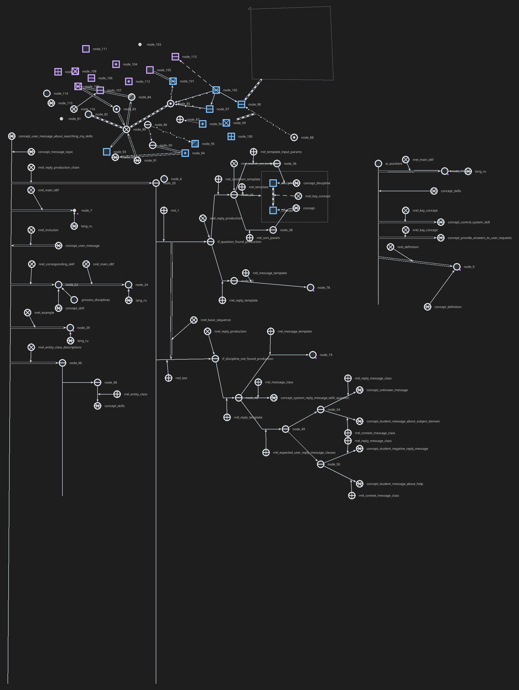

# KB-Studio

**A desktop IDE for OSTIS knowledge bases.** Browse a project, edit SC-code as
text or as an SCg graph, and ask an AI assistant about the knowledge base — all
in one window.

<p align="center">
  
  
  
</p>

<p align="center">
  
</p>

<p align="center">
  An SCg graph produced with the KB-Studio graph editor (PNG export).
</p>

## Features

### Workspace

- Project tree with file and directory creation, rename and delete.
- Tabbed SCs editors, a collapsible left/right sidebar and a light/dark theme
  that switches live without restarting.
- Settings for the theme, auto-save and AI chat behaviour.
- Path-traversal protection for every project file operation.

### SCs text editor

- Syntax highlighting and live error reporting based on the OSTIS SCs grammar
  (Lark), with the error position marked in the text.
- Line numbers, bracket auto-completion, zoom (`Ctrl++` / `Ctrl+-`) and
  optional auto-save.
- Tabs keep unsaved changes and restore the last opened files on startup.

### SCg graph editor

- Typed constant, variable and meta nodes (general, role, relation, class,
  structure, tuple, …) and typed directed/undirected connectors, including
  membership arrows, meta connectors and dot balances.
- Buses and contours; connectors attach to node borders, other connectors and
  contour boundaries.
- Canvas notes for comments that never enter the saved GWF model.
- Copy, cut and paste of graph fragments through the system clipboard,
  including fragments copied from other GWF documents.
- Undo/redo for every edit, in-place rename, connector waypoints, node content
  attachments, node search, zoom, fit-to-graph and PNG export.
- Full GWF 1.6/2.0 round-trip: unedited metadata, element order, route points
  and unsupported elements are preserved.
- Builder-safe export: types the ostis-ai `sc-builder` cannot resolve are
  rewritten on save, and `rrel_*` elements are stored as role relations
  (`node/const/attribute`) instead of non-role relations.

### AI assistant

- OpenAI-compatible providers and models, configured in the app.
- API keys are encrypted at rest; model settings are stored per model.
- Files explicitly attached by the user are sent as request context.
- Configurable startup history and context size; requests can be cancelled
  and the app waits for the worker before closing.

## Getting started

KB-Studio needs **Python 3.10+** and a desktop session with Qt 6.

```bash
python -m venv .venv
source .venv/bin/activate
python -m pip install -r requirements.txt
python main.py
```

On Windows use `.venv\Scripts\activate` instead.

## Keyboard shortcuts

### Graph editor

| Shortcut | Action |
| --- | --- |
| `Ctrl+C` / `Ctrl+X` / `Ctrl+V` | Copy, cut, paste the selection |
| `Ctrl+Shift+V` | Paste in place (keep source coordinates) |
| `Del` | Delete the selected nodes, connectors, buses, contours and notes |
| `F2` | Rename a node or edit a note |
| `Ctrl+E` | Add or edit node content |
| `Ctrl+Shift+A` | Select all incoming/outgoing nodes |
| `Ctrl+Shift+C` | Copy the incoming/outgoing fragment |
| `Ctrl+G` | Wrap the selection in a contour |
| `Ctrl+R` | Reverse a pair connector |
| `Ctrl+N` | Add a general node |
| `Ctrl+Shift+N` | Add an nrel node |
| `Ctrl+Alt+N` | Add an rrel (role) node |
| `Ctrl+Alt+V` | Add a variable node |
| `Ctrl+Shift+M` | Add a note at the pointer |
| `Ctrl+S` | Save the graph |
| `Ctrl+Z` / `Ctrl+Shift+Z` / `Ctrl+Y` | Undo / redo |

Creation shortcuts place objects at the last pointer position and fall back to
the viewport centre before the pointer enters the canvas. Middle-mouse drag or
`Space` + left drag pans the canvas.

## Building a standalone executable

PyInstaller produces a single-file executable for the current operating system
and architecture; it does not cross-compile. Build on the oldest OS version you
intend to support, because the executable inherits the build machine's C
library and other system dependencies.

### Linux

The repository includes `Dockerfile.build`, which builds on Ubuntu 22.04
(glibc 2.35). The result runs on Ubuntu 22.04+, Debian 12+, Ubuntu 24.04,
Fedora, Arch and other distributions with glibc 2.35 or newer.

```bash
DOCKER_BUILDKIT=1 docker build -f Dockerfile.build --output type=local,dest=dist .
./dist/KB-Studio
```

The image installs Python 3.10, the Qt runtime libraries (so PyInstaller can
collect the Qt plugins), `binutils` and PyInstaller, then runs
`pyinstaller --noconfirm --clean KB-Studio.spec`.

For a native build (the executable then requires the host's glibc):

```bash
python -m pip install -r requirements.txt pyinstaller
python build_assets.py          # only after changing files in src/resources/icons
pyinstaller --noconfirm KB-Studio.spec
./dist/KB-Studio
```

### Windows and macOS

Build on the oldest Windows or macOS version you intend to support, using the
same `pyinstaller --noconfirm KB-Studio.spec` command. PyInstaller must run on
the target OS; sign and notarize macOS builds before distributing them.

## Testing

```bash
python -m unittest discover tests
```

The suite covers the graph editor, the SCs parser and editor, the AI worker,
history, security and syntax highlighting. The GUI tests need a Qt platform
plugin; on a headless Linux machine run them under a virtual display, for
example `xvfb-run -a python -m unittest discover tests`.

## Project layout

```
main.py                     application entry point
Dockerfile.build            reproducible Ubuntu 22.04 build
scripts/check-glibc.py      bundled glibc audit
src/
  core/                     signals and the AI worker
  gui/
    code_editor/            SCs text editor and tabs
    graph_editor/           SCg canvas, items, commands, GWF codec, theme
    left_sidebar/           project tree
    right_sidebar/          AI chat
    main_window.py          window, sidebars, editor switch
    toolbar.py, settings.py
  lark_syntax/              SCs grammar and parser
  resources/                themes, icons, prompts
  utils/                    config, theme, security, file helpers
tests/                      unittest suite
```

## Linux compatibility

The released Linux executable is built on Ubuntu 22.04 and requires **glibc
2.35 or newer**, together with the usual desktop libraries (`libGL`,
`libEGL`, `libxkbcommon`, fontconfig, ...). It does not start on Ubuntu 20.04
or Debian 11 (glibc 2.31).

Auditing only the top-level executable is misleading: it is the PyInstaller
bootloader and references just `GLIBC_2.14`. The real requirement comes from
the bundled native libraries, mainly `libpython3.10.so.1.0` and
`libgcc_s.so.1`. Inspect every ELF file in the bundle with:

```bash
python scripts/check-glibc.py dist/KB-Studio
```

The script reports the highest glibc version and the libraries that need it,
and `--max 2.35` turns it into a CI check. It requires `readelf` (binutils)
and PyInstaller.

The definitive test is to run the executable on each target distribution. For
a headless smoke test:

```bash
QT_QPA_PLATFORM=offscreen ./dist/KB-Studio
```

Build and test separately for each operating system and architecture.

## License

[MIT](LICENSE) © 2026 technowizardx

Toolbar icons use the [Lucide](https://lucide.dev) icon set (ISC license, see
`src/resources/icons/`).
